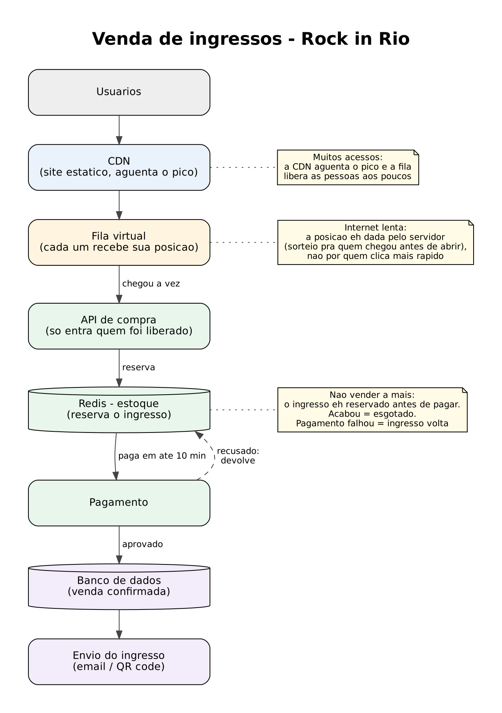

# Sistema de venda de ingressos - Rock in Rio

Arquitetura que eu pensei para o exercício.

## Como funciona

1. O usuário acessa o site, que é estático e fica na **CDN**. Assim o pico de acessos não derruba o servidor.
2. Todo mundo entra numa **fila virtual** e recebe uma posição.
3. A fila vai liberando as pessoas aos poucos para a **API de compra**.
4. O ingresso é **reservado no Redis** (o estoque diminui na hora) e a pessoa tem 10 minutos para pagar.
5. Se o **pagamento** for aprovado, a venda é salva no **banco de dados** e o ingresso é enviado por e-mail. Se for recusado ou o tempo acabar, o ingresso volta para o estoque.

## Requisitos

- **Muitos acessos:** a CDN segura o pico e a fila controla quantas pessoas compram ao mesmo tempo.
- **Não vender sem ter ingresso:** o ingresso é reservado antes do pagamento. Quando o estoque acaba, aparece "esgotado".
- **Internet lenta não perde a vez:** a posição na fila é definida pelo servidor. Quem entrou antes da abertura recebe posição por sorteio, então não ganha quem clica mais rápido.
